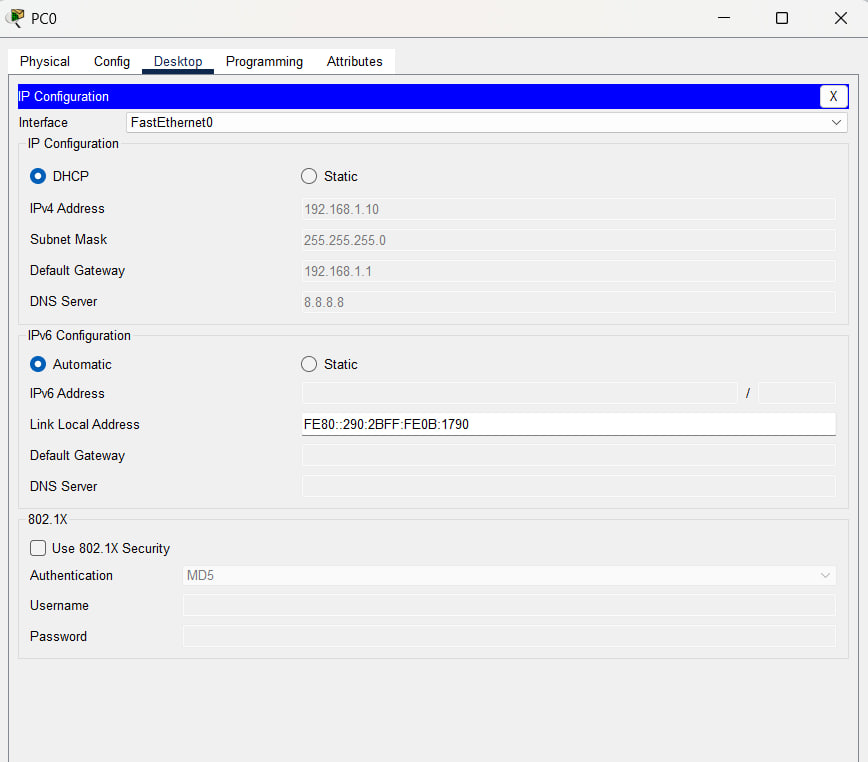
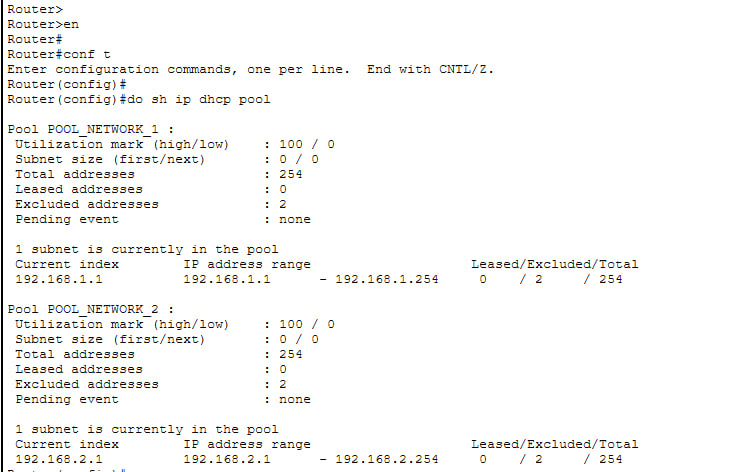
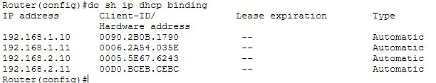

# Lab 2: Automating IP Addressing with DHCP (Packet Tracer)

[← Previous lab](../01-reseau-lan-simple) · [Series index](../README.md) · [Next lab →](../03-access-list)

| File | Content |
|---|---|
| `tp2.pkt` | Packet Tracer file for this lab |
| `configs/` | Device configurations (text) |
| `images/` | Screenshots |

📝 LinkedIn article: https://lnkd.in/p/dVZ-xN6i

**Level:** Beginner
**Prerequisite:** Lab 1 (LAN with two subnets and inter-network routing)
**Objective:** Replace the static addressing of the 4 PCs with automatic assignment through DHCP, configured on the router.
**Estimated time:** 15-20 minutes

---

## 1. Topology (same as Lab 1)

```
        [PC0]                                   [PC2]
          |                                        |
        [Switch0] ---- [Router0] ---- [Switch1]
          |                                        |
        [PC1]                                   [PC3]
```

- Network 1 (Switch0 side): 192.168.1.0/24, gateway 192.168.1.1
- Network 2 (Switch1 side): 192.168.2.0/24, gateway 192.168.2.1

If you start from a new Packet Tracer file, rebuild the Lab 1 topology first.

---

## 2. Why DHCP?

Configuring each PC by hand works for 4 machines. It does not scale to 200 workstations, and it multiplies human errors (duplicate IPs, forgotten gateways). **DHCP (Dynamic Host Configuration Protocol)** centralizes the assignment: the router (or a dedicated server) automatically hands out an IP address, mask, gateway and DNS server to every PC that asks for them.

**Simple rule:** anything that *serves* or *routes* (routers, servers) keeps a fixed IP. Anything that *consumes* (PCs, laptops, phones) uses DHCP.

---

## 3. Step 1: Address the router interfaces (mandatory prerequisite)

A DHCP pool is useless if the router does not have an address in the network it is supposed to serve.

```
enable
configure terminal

interface GigabitEthernet0/0
 ip address 192.168.1.1 255.255.255.0
 no shutdown
 exit

interface GigabitEthernet0/1
 ip address 192.168.2.1 255.255.255.0
 no shutdown
 exit
```

Check with `show ip interface brief`: Gi0/0 and Gi0/1 must show their IP address and be **up / up**.

---

## 4. Step 2: Configure the two DHCP pools

Create **two separate pools**, one per subnet, because each network has its own gateway.

```
! --- Pool for network 192.168.1.0/24 ---
ip dhcp excluded-address 192.168.1.1 192.168.1.9
ip dhcp pool POOL_NETWORK_1
 network 192.168.1.0 255.255.255.0
 default-router 192.168.1.1
 dns-server 8.8.8.8
 exit

! --- Pool for network 192.168.2.0/24 ---
ip dhcp excluded-address 192.168.2.1 192.168.2.9
ip dhcp pool POOL_NETWORK_2
 network 192.168.2.0 255.255.255.0
 default-router 192.168.2.1
 dns-server 8.8.8.8
 exit

end
write memory
```

**Why `ip dhcp excluded-address`?**
The pool covers the whole subnet (.1 to .254), and the router does not know which addresses you already use statically. Without an exclusion, it could hand a PC an address that is already taken (for example the gateway 192.168.1.1), which creates an IP conflict.

Typically you exclude:
- the router's own address (the gateway);
- devices with a fixed IP (servers, printers, managed switches, access points);
- optionally, a range reserved for future fixed-IP devices.

Here, .1 to .9 are excluded: PCs will receive addresses starting at .10.

> **Note:** Cisco IOS often probes an address (ping) before assigning it and skips it if it answers. You cannot rely on this, because a device that does not answer pings slips through. Exclusions remain the best practice.
>
> **About command order:** what matters is that the exclusion is in place **before PCs request an address**. A PC that already received an address keeps it until its lease expires.

---

## 5. Step 3: Configure the PCs

On each PC (PC0 to PC3): **Desktop → IP Configuration → select "DHCP"** (instead of "Static"). Do not enter any IP, mask or gateway.

Packet Tracer then sends a DHCP request, and the PC automatically receives its IP, mask, gateway and DNS server.



---

## 6. Verification

On each PC, in **IP Configuration**, you should see an automatically assigned IP (192.168.1.x or 192.168.2.x depending on the switch).

On the router:
```
show ip dhcp pool
show ip dhcp binding
```
- `show ip dhcp pool`: lists the pools, with the number of leased and excluded addresses.


- `show ip dhcp binding`: lists active leases (IP, PC MAC address, expiration). You should see 4 lines.



Connectivity test:
```
ping <IP of PC2>     (from PC0)
```
It must succeed: DHCP changes nothing about routing, only the way addresses are assigned.

---

## 7. The classic pitfall: "the pools are fine but nobody gets an IP"

If `show ip dhcp binding` is empty and `show ip dhcp pool` shows `Leased addresses: 0`, no request has reached the router. Check, in this order:

1. **`show ip interface brief`**: do Gi0/0 and Gi0/1 have their IP address? If they show **"unassigned"**, the router has no address in the networks it should serve and stays deaf to DHCP requests. This is the most common cause when starting from a new file.
2. Are the interfaces **up / up**? If not: `no shutdown` is missing, or there is a cabling problem.
3. Are the PCs really in **DHCP** mode? Switch to Static, then back to DHCP, to resend the request.
4. Are the links green? If they are orange, wait 30 seconds or use "Fast Forward Time".

---

## 8. Key takeaways

- DHCP works with **leases**: an address is lent for a given duration.
- A DHCP pool only has an effect if the router has an interface in the matching network.
- Fixed addresses must be **excluded** to avoid conflicts.
- A Cisco router can serve several pools, one per subnet.

---

## 9. Next lab

[Lab 3](../03-acl): **Access Control Lists (ACLs)** to control who can talk to whom between the two networks.

---

## Screenshots

Add your screenshots to the images/ folder, then uncomment the lines below:


