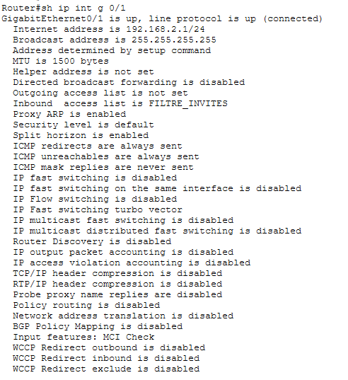
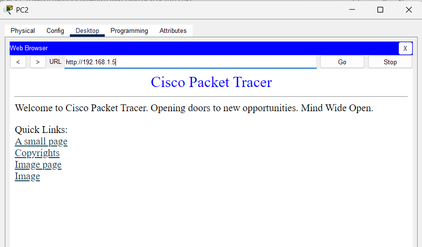
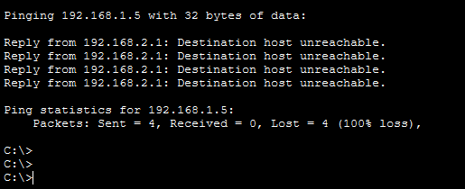
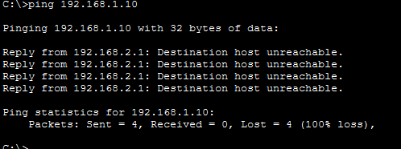
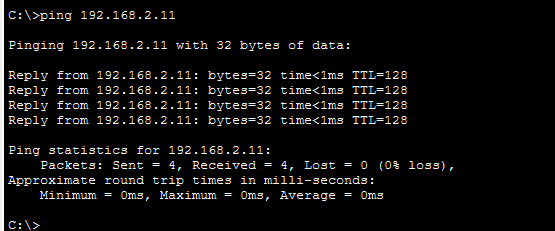
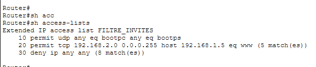
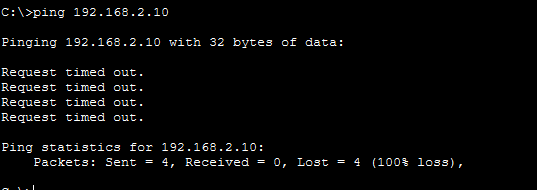

# Lab 3: Controlling Traffic with ACLs (Packet Tracer)

[← Previous lab](../02-dhcp) · [Series index](../README.md)

| File | Content |
|---|---|
| `tp03.pkt` | Packet Tracer file for this lab |
| `configs/` | ACL configurations (standard and extended) |
| `images/` | Screenshots |

📝 LinkedIn article: [FR](#) · [EN](#)

**Level:** Beginner → intermediate
**Prerequisites:** Lab 1 (inter-network routing) and Lab 2 (DHCP)
**Objective:** Use the router's Access Control Lists (ACLs) to filter traffic between the two networks: first a standard ACL, then an extended ACL.
**Estimated time:** 60–75 minutes

---

## 1. Topology: the Lab 2 setup plus a server

```
 [PC0] [PC1] [Server0]                    [PC2] [PC3]
    \    |    /                              \    /
     [Switch0] ------- [Router0] ------- [Switch1]
```

Add **a server** (Server-PT) connected to **Switch0** (network 1):

| Device | Network | IP address | Configuration |
|---|---|---|---|
| Server0 | 192.168.1.0/24 | **192.168.1.5** (static) | mask 255.255.255.0, gateway 192.168.1.1 |

> **Link with Lab 2:** 192.168.1.5 belongs to the range excluded from DHCP (.1 to .9). That is exactly the purpose of exclusions: reserving addresses for fixed-IP devices.

The server's **HTTP** service is enabled by default in Packet Tracer (tab *Services → HTTP*). Make sure it is set to "On".

**Before you start:** check that everything works (the 4 PCs get an IP through DHCP, PC0 can ping PC2 and the server). Never filter a network you have not tested first.

---

## 2. What is an ACL?

An ACL is a list of "permit / deny" rules that the router reads **from top to bottom** for each packet, on a given interface and in a given direction (`in` = inbound, `out` = outbound).

Three rules to remember:
1. **The first matching rule wins.** The router stops there, so order is crucial.
2. **Implicit deny at the end.** If no rule matches, the packet is dropped (an invisible `deny any` ends every ACL).
3. **An ACL does nothing until it is applied** to an interface with `ip access-group`.

| Type | Filters on | Where to place it |
|---|---|---|
| **Standard** (numbers 1–99) | the **source** IP address only | **close to the destination** |
| **Extended** (numbers 100–199, or named) | source, destination, protocol, port | **close to the source** |

**The wildcard mask:** in an ACL you do not write 255.255.255.0 but its inverse, 0.0.0.255. A `0` means "this bit must match", and a `255` means "don't care". So `192.168.2.0 0.0.0.255` = the whole 192.168.2.x network, and `host 192.168.2.11` = that machine only.

---

## 3. Part A: Standard ACL, block one host

**Scenario:** PC3 (192.168.2.11) must no longer reach network 1. The other machines in network 2 keep their access.

> **Warning:** the addresses come from DHCP and can swap between PC2 and PC3 (for example after a new round of requests). Before writing the ACL, check PC3's current address in *Desktop → IP Configuration*, and replace `192.168.2.11` with that address if it differs.

A standard ACL only looks at the source, so we place it **close to the destination**: on Gi0/0, in the **outbound** direction (toward network 1).

```
enable
configure terminal

access-list 10 deny host 192.168.2.11
access-list 10 permit any

interface GigabitEthernet0/0
 ip access-group 10 out
 exit

end
```

The `permit any` line is essential: without it, the implicit deny would block **everyone**.

**What each command does**

| Command | What it does |
|---|---|
| `enable` | Enters privileged mode. |
| `configure terminal` | Enters global configuration mode. |
| `access-list 10 deny host 192.168.2.11` | Creates numbered list 10 (standard, since 1–99) with a rule: deny any packet whose source is exactly 192.168.2.11. |
| `access-list 10 permit any` | Adds the next rule: permit everything else. |
| `interface GigabitEthernet0/0` | Enters the configuration of the network 1 interface. |
| `ip access-group 10 out` | Applies ACL 10 to this interface, **outbound** (packets leaving the router toward network 1). |
| `exit` / `end` | Goes back one level / back to privileged mode. |

### Verification
- From **PC3**: `ping 192.168.1.10` (or any PC in network 1) → must **fail**.
- From **PC2**: same ping → must **succeed**.
- On the router: `show access-lists` → each rule shows a packet counter (`matches`). This is how you check that a rule really works.
- `show ip interface GigabitEthernet0/0` → line "Outgoing access list is 10".

**Observed results**
- PC3 → PC1: 4 packets lost, with `Reply from 192.168.2.1: Destination host unreachable`. The **router** (its network 2 address) is refusing the packet.
- PC3 → PC2: succeeds. Same network, so the traffic never reaches the router and the ACL cannot see it.
- PC2 → PC1: succeeds. The first packet times out because the router first has to learn PC1's MAC address (ARP).
- `show access-lists`: `10 deny host 192.168.2.11 (4 match(es))` and `20 permit any (8 match(es))`, matching the packets sent.

### Cleanup before Part B
```
configure terminal
interface GigabitEthernet0/0
 no ip access-group 10 out
 exit
no access-list 10
end
```

| Command | What it does |
|---|---|
| `no ip access-group 10 out` | Removes the ACL from the interface (the list still exists but is no longer active). |
| `no access-list 10` | Deletes list 10 and all its rules. |

---

## 4. Part B: Extended ACL, allow only web traffic to the server

**Scenario:** hosts in network 2 (guests) may only reach the server's **web service (HTTP)** at 192.168.1.5. Everything else toward network 1 is forbidden.

We filter close to the source: on Gi0/1, in the **inbound** direction (traffic from network 2 arriving at the router).

```
configure terminal

ip access-list extended FILTRE_INVITES
 permit udp any eq 68 any eq 67
 permit tcp 192.168.2.0 0.0.0.255 host 192.168.1.5 eq 80
 deny ip any any
 exit

interface GigabitEthernet0/1
 ip access-group FILTRE_INVITES in
 exit

end
write memory
```

**What each command does**

| Command | What it does |
|---|---|
| `ip access-list extended FILTRE_INVITES` | Creates a **named extended** ACL and enters its mode (prompt `Router(config-ext-nacl)#`). |
| `permit udp any eq 68 any eq 67` | Permits clients' DHCP requests: UDP, source port 68 (client), destination port 67 (DHCP server). |
| `permit tcp 192.168.2.0 0.0.0.255 host 192.168.1.5 eq 80` | Permits web traffic: TCP, from the whole of network 2, to 192.168.1.5 only, on port 80 (HTTP). |
| `deny ip any any` | Explicitly denies everything else. It would exist implicitly anyway, but written out it shows a match counter. |
| `interface GigabitEthernet0/1` | Enters the configuration of the network 2 interface. |
| `ip access-group FILTRE_INVITES in` | Applies the ACL **inbound** (packets arriving from network 2 at the router). |
| `write memory` | Saves the configuration so it survives a reboot. |

### Why the first line (`permit udp any eq 68 any eq 67`)?
It is the clients' **DHCP** request (source port 68, destination port 67). Without it, the ACL would block DHCP requests from network 2: a PC renewing its lease would no longer receive an address. This illustrates an important principle: **an ACL can break services you did not think about.**

### Verification
- `show ip interface GigabitEthernet0/1` → line "Inbound access list is FILTRE_INVITES".
- From **PC2**, *Desktop → Web Browser*: `http://192.168.1.5` → the server's page **is displayed**.
- From **PC2**: `ping 192.168.1.5` → **fails** (ICMP is not allowed).
- From **PC2**: `ping 192.168.1.10` (PC0) → **fails**.
- From **PC2**: `ping` to PC3 → **succeeds** (same network, the router is not involved).
- `show access-lists` → the counters of `permit tcp` and `deny ip any any` increase as you test.

**Observed results**
- `show ip interface GigabitEthernet0/1`: "Inbound access list is FILTRE_INVITES", "Outgoing access list is not set".
- The server's web page is displayed from PC2.
- `ping 192.168.1.5` and `ping 192.168.1.10`: 100% loss, with "Destination host unreachable" coming from 192.168.2.1 (the router).
- `ping 192.168.2.11`: 0% loss.
- `show access-lists`: line 10 (DHCP) has no counter (no DHCP request during the tests), line 20 (web) shows **5 matches** (the web session), line 30 (`deny ip any any`) shows **8 matches** (4 pings to .1.5 + 4 pings to .1.10).
- Optional test, PC0 → PC2: "Request timed out". The request reaches PC2, but its reply is denied as it enters the router (see pitfall 5).









> Depending on the Packet Tracer version, a denied packet shows as "Request timed out" or "Destination host unreachable". The "unreachable" message is sent by the router to the **sender of the denied packet**. That is why PC2 sees it for its own pings, while PC0, whose *reply* is the denied packet, only sees silence.

---

## 5. Classic pitfalls

1. **ACL created but not applied.** Without `ip access-group`, nothing happens.
2. **Wrong direction (`in` / `out`) or wrong interface.** Always ask yourself: "where does the packet come from, and where do I intercept it?"
3. **Rule order.** If a broad `permit` comes before a specific `deny`, the `deny` is never reached.
4. **The implicit deny.** An ACL containing only `deny` rules blocks everything. Remember the final `permit`.
5. **ACLs are stateless.** In Part B, PC0 (network 1) can no longer ping PC2: the request leaves fine, but PC2's **reply** comes back through Gi0/1 inbound, and the ACL rejects it. A classic ACL does not "remember" that a conversation was started from the other side. This is the limit that stateful firewalls (such as **FortiGate**, covered later in the series) solve.
6. **Editing a numbered ACL** is painful: you cannot easily insert a line in the middle. **Named** ACLs (like `FILTRE_INVITES`) are easier to maintain.
7. **An ACL targets an IP address, not a machine.** With DHCP, a PC's address can change: PC2 and PC3 can swap addresses, and the ACL then blocks the wrong machine. Check the current addresses in *IP Configuration*, or give the machine you want to filter a fixed address (outside the DHCP range).

---

## 6. Key takeaways

- An ACL is a list of rules read top to bottom: **first match wins**, with an **implicit deny** at the end.
- Standard = filters on the source, placed close to the destination. Extended = fine-grained filtering (protocol, ports), placed close to the source.
- An ACL must be **applied** to an interface, in a specific direction.
- Always test **before** and **after**, and read `show access-lists`.

---

## 7. A limitation to know: ACLs only filter routed traffic

A router ACL only sees packets that **pass through the router**. In this lab the server is connected to Switch0, in the same network as PC0 and PC1:
- traffic from **network 2 to the server** crosses the router, so the ACL can filter it;
- traffic from **PC0 or PC1 to the server** stays inside Switch0, so **no router ACL can filter it**.

To force all traffic to the server through the router, you can connect the server **directly to the router**, on its own interface and its own subnet (for example 192.168.3.0/24 on Gi0/2), as a separate "server zone". In Packet Tracer this link needs a cross-over cable (Copper Cross-Over). You can also segment inside a switch with **VLANs** (next lab).

This lab keeps the server on Switch0 on purpose: the goal is to learn the ACL fundamentals (rule order, implicit deny, direction, placement). A third subnet would make the lab longer without adding to those concepts.

---

## 8. What's next

This lab is a **preview of network security**. The series now goes back to the CCNA fundamentals, starting with **CCNA Lab 2: the OSI and TCP/IP models in Simulation mode** (see the `ccna/` folder). ACLs return in depth in the Security phase, and VLANs in the Access phase.

---

## Screenshots

Add your topology and Part A captures to `images/`, then reference them like this:

```


```
